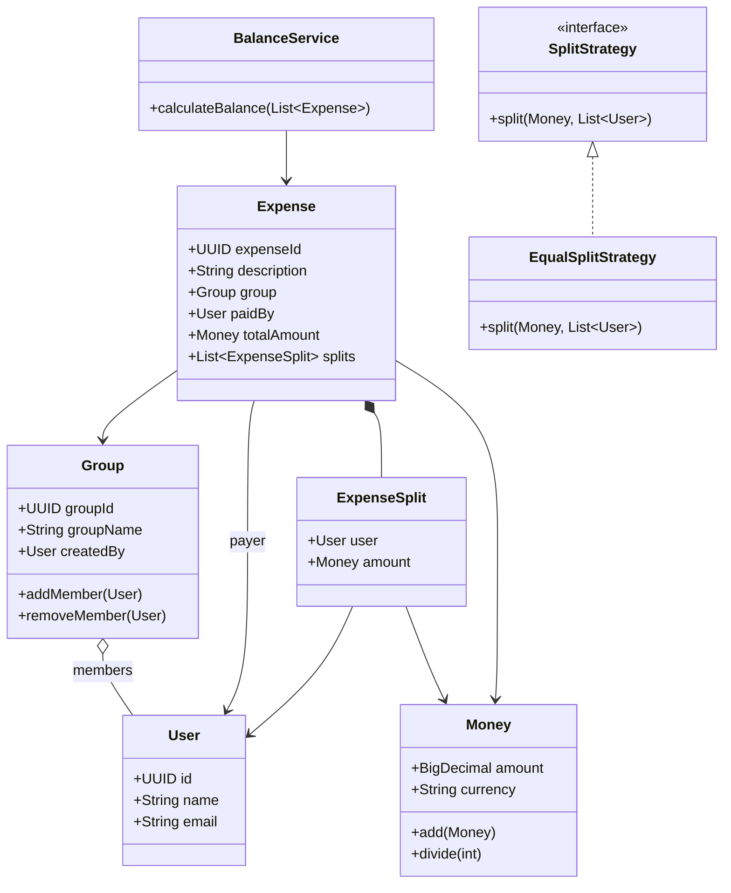

# Splitwise Backend — Java LLD MVP

A small, interview-focused implementation of the core Splitwise domain in Java. The project is designed to demonstrate object-oriented design, clear domain boundaries, the Strategy pattern, monetary correctness, and balance calculation without introducing a framework or database prematurely.

> **Project status:** In-memory MVP in progress. The README distinguishes the current implementation from planned capabilities so the documentation does not promise features that may not yet exist in code.

## Contents

- [Goals](#goals)
- [Technology](#technology)
- [Current implementation](#current-implementation)
- [Domain model](#domain-model)
- [How balances work](#how-balances-work)
- [Planned behavior](#planned-behavior)
- [Project structure](#project-structure)
- [Build and run](#build-and-run)
- [Design decisions](#design-decisions)
- [Validation and edge cases](#validation-and-edge-cases)
- [Interview discussion guide](#interview-discussion-guide)
- [Roadmap](#roadmap)

## Goals

The MVP models the essential expense-sharing workflow:

1. Represent users and groups.
2. Record an expense and the share assigned to each participant.
3. Calculate each user's net position from expenses.
4. Extend the model to support payment suggestions and recorded settlements.
5. Keep the business logic understandable and easy to explain in a 35–45 minute LLD interview.

The emphasis is on correctness and separation of responsibilities—not on adding infrastructure for its own sake.

## Technology

- **Java 21**
- **Maven**
- **JUnit 5**
- **Java collections** for in-memory data
- **Mermaid** for diagrams in this README

The MVP does not require Spring Boot, a database, REST APIs, authentication, Kafka, or Redis.

## Current implementation

The following reflects the baseline implementation currently described by the project work. Treat the status of recently added classes as unverified until they are present in the repository and compile successfully.

| Component | Responsibility | Status |
|---|---|---|
| `User` | Represents a user with an ID, name, and email | Implemented |
| `Group` | Maintains group membership and prevents removing the creator | Implemented |
| `Money` | Represents a non-negative monetary amount and currency | Implemented |
| `ExpenseSplit` | Associates a participant with their share of an expense | Implemented |
| `Expense` | Holds the payer, group, total, description, and participant shares; validates membership and total allocation | Implemented |
| `SplitStrategy` | Common contract for split calculations | Implemented |
| `EqualSplitStrategy` | Calculates equal shares and rejects duplicate participants | Implemented |
| `BalanceSheet` | Simple per-user amount accumulator | Implemented, but not suitable for signed net balances |
| `BalanceService` | Calculates signed net positions from expenses | Implemented baseline |
| `ExpenseService` | Coordinates expense creation and retrieval | Planned / verify in code |
| `PaymentSuggestion` | Represents a suggested payment from one user to another | Planned / verify in code |
| `DebtSimplifier` | Simplifies balances into suggested payments | Planned / verify in code |
| `Settlement` | Represents an actual payment between users | Planned / verify in code |
| `SettlementService` | Validates and records actual payments | Planned / verify in code |

### Supported split strategy

The current strategy implementation is equal splitting. Exact and percentage splitting can be added later through the same `SplitStrategy` abstraction.

## Domain model



### Core domain rules

- A user and group have stable IDs.
- A group creator is added to the group when it is created.
- An expense payer must be a member of the expense's group.
- Every participant in an expense split must belong to that group.
- Split amounts must add up to the expense total.
- A split is a participant's allocated share; it is not itself a payment or an outstanding debt.
- `Money` values may only be added when their currency codes match.

## How balance calculation works

For each expense, the service:

1. Credits the payer with the full amount they paid.
2. Debits each participant by their allocated share.
3. Adds those signed amounts to a per-user balance.

The resulting net position is interpreted as follows:

- **Positive:** the user should receive money.
- **Negative:** the user owes money.
- **Zero:** the user's net position is settled.

### Example

Alice pays ₹900 for an expense shared equally by Alice, Bob, and Charlie.

| User | Paid | Share | Net balance |
|---|---:|---:|---:|
| Alice | ₹900 | ₹300 | +₹600 |
| Bob | ₹0 | ₹300 | −₹300 |
| Charlie | ₹0 | ₹300 | −₹300 |
| **Total** | **₹900** | **₹900** | **₹0** |

The sum of net balances should be zero when the expense is fully allocated. The payer's own share is accounted for by crediting the full payment and debiting their allocated share.

> **Current limitation:** the baseline `BalanceService` calculates balances from expenses only. Recorded settlements must be incorporated before its output represents the remaining amount owed after payments.

## Planned behavior

### 1. Group-wise and global balances

Two calculation scopes are planned:

- **Group-wise:** calculate net positions using expenses and settlements belonging to one group.
- **Global:** calculate net positions across a selected set of groups, allowing a user's position in one group to offset their position in another.

For global calculations, include only the groups the user intends to combine. Never combine different currencies into one balance unless explicit exchange-rate conversion is implemented.

### 2. Debt simplification

`DebtSimplifier` will take a set of signed net balances and produce `PaymentSuggestion` objects. It should not mutate expense history or record actual payments.

A greedy debtor/creditor matching algorithm is a good initial implementation. It can reduce the number of payments, though it does not guarantee the globally minimum number for every possible balance distribution.

### 3. Settlements

A `Settlement` represents an actual payment from a payer to a receiver. `SettlementService` will validate and record payments, and balance calculation will account for those recorded settlements.

The design must distinguish these concepts:

- **Payment suggestion:** a recommendation for what someone could pay.
- **Recorded settlement:** a payment that has actually happened.

The service should reject invalid amounts and, when the balance workflow is integrated, prevent a payment from exceeding the relevant outstanding amount.

## Project structure

Expected package layout:

```text
src/
├── main/
│   └── java/com/ashim/splitwise/
│       ├── model/
│       │   ├── User.java
│       │   ├── Group.java
│       │   ├── Money.java
│       │   ├── Expense.java
│       │   ├── ExpenseSplit.java
│       │   └── BalanceSheet.java
│       ├── strategy/
│       │   ├── SplitStrategy.java
│       │   └── EqualSplitStrategy.java
│       └── service/
│           └── BalanceService.java
└── test/
    └── java/com/ashim/splitwise/
        ├── model/
        │   └── MoneyTest.java
        └── strategy/
            └── EqualSplitStrategyTest.java
```

Update this tree as additional classes are implemented. The repository is currently an in-memory domain exercise; there is no repository or database layer in the baseline design.

## Build and run

You need JDK 21 and Maven installed.

Compile the project:

```bash
mvn -q -DskipTests compile
```

Run the test suite:

```bash
mvn test
```

If Maven reports a duplicate `org.junit.jupiter:junit-jupiter` dependency in `pom.xml`, remove the duplicate declaration and keep one versioned dependency.

## Design decisions

### `BigDecimal` for money

Financial values should not use `double` because binary floating-point arithmetic can introduce representation errors. `Money` uses `BigDecimal` and checks currency compatibility for addition.

### Currency-aware amounts

Amounts with different currencies must not be added together. A future multi-currency implementation should define exchange-rate sources, conversion timing, rounding rules, and the currency in which each user's balance is presented.

### Immutable value objects and defensive copies

`Money` is immutable. Collections exposed by models and services should be returned as immutable snapshots so callers cannot accidentally mutate internal state.

### Strategy pattern for splitting

`SplitStrategy` isolates the algorithm that calculates participant shares from expense creation. New split types can be added as separate implementations rather than growing one large conditional block.

### Separate calculation from side effects

`BalanceService` calculates balances. `DebtSimplifier` proposes payments. `SettlementService` records actual payments. Keeping these responsibilities separate makes each component easier to test and explain.

### In-memory storage is a deliberate MVP trade-off

Collections are sufficient to demonstrate domain behavior. A repository abstraction and persistent database can be introduced later if durability, querying, or concurrent access becomes part of the requirements.

## Validation and edge cases

The implementation should preserve these invariants as it evolves:

- Reject missing users, groups, amounts, and participant lists.
- Reject negative expense amounts and non-positive settlement amounts.
- Reject duplicate participants in one split.
- Ensure the payer and participants satisfy the group's membership rules.
- Ensure all split amounts sum exactly to the expense total.
- Distribute leftover minor currency units deterministically for equal splits (for example, ₹100 among three users becomes ₹33.34, ₹33.33, and ₹33.33).
- Reject mixed currencies in a single balance calculation.
- Ensure all net balances sum to zero, subject to exact minor-unit allocation.
- Ensure settlements reduce the relevant outstanding balances exactly once.
- Keep suggested payments separate from recorded settlements.

## Interview discussion guide

Be ready to explain:

1. **Why `Money` is a value object:** it keeps amount and currency together and centralizes monetary rules.
2. **Why use `BigDecimal`:** it avoids binary floating-point errors in financial calculations.
3. **Why use `SplitStrategy`:** it separates algorithms and supports extension without changing the expense workflow.
4. **Why separate `ExpenseSplit` and `Settlement`:** a share is an allocation; a settlement is a real transfer of money.
5. **How balances are derived:** credit the payer, debit each participant's share, then account for recorded settlements.
6. **Group-wise versus global simplification:** use one group's balance scope or combine a selected set of groups, without mixing currencies.
7. **What the greedy simplifier guarantees:** valid net settlement suggestions with fewer transactions in many cases, not always the theoretical minimum.
8. **What changes for production:** persistence, transactional settlement recording, concurrency controls, authorization, API validation, and auditability.

## Roadmap

- [x] Create the core domain models.
- [x] Add `Money` and equal split strategy.
- [x] Add baseline expense-based balance calculation.
- [ ] Fix equal-split remainder distribution.
- [ ] Implement and integrate `ExpenseService`.
- [ ] Add group-wise and global balance calculation.
- [ ] Implement `PaymentSuggestion` and `DebtSimplifier`.
- [ ] Implement `Settlement` and `SettlementService`.
- [ ] Add integration and edge-case tests.
- [ ] Update this README to match the final implementation and diagrams.

## Definition of done

The MVP is complete when the code and documentation agree, the application compiles, split totals are exact, balances remain consistent across expenses and settlements, group-wise and global calculations behave as specified, debt simplification emits valid suggestions, and the test suite passes.
