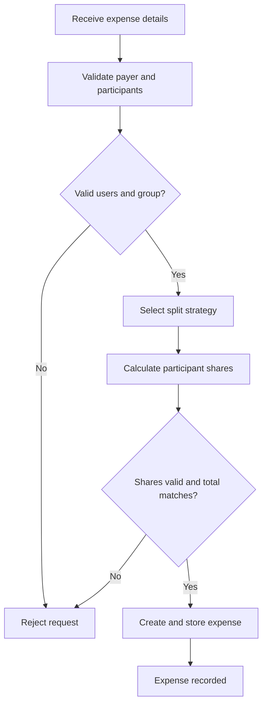
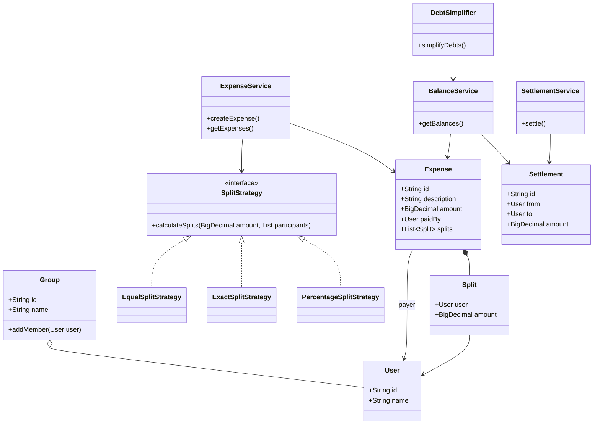

# Splitwise MVP — Low-Level Design in Java

## 1. Project Overview

A minimal, interview-oriented implementation of Splitwise using Java 21, Maven, and JUnit 5.

The application allows users to record shared expenses, split costs among participants, calculate outstanding balances, and record settlements.

**Primary goal:** Practice object-oriented design, SOLID principles, Strategy pattern, monetary calculations, and unit testing through a working Java application.

## 2. Technology Stack

- Java 21
- Maven
- JUnit 5
- In-memory storage using Java collections
- Mermaid diagrams for design documentation

No Spring Boot, database, REST APIs, authentication, or external infrastructure is required for this MVP.

## 3. Functional Requirements

### 3.1 Users

- Create users with a unique ID and name.
- Identify users when recording expenses and settlements.

### 3.2 Groups

- Create a group with a name and members.
- Add expenses associated with a group.
- Ensure expense participants belong to the group.
- Support expenses between individual users without requiring a group.

### 3.3 Expense Management

- Record an expense with a description, total amount, payer, participants, and split details.
- Support expenses inside or outside a group.
- View recorded expenses.

The expense description is free-form text. Examples include dinner, rent, cab, groceries, and movie tickets. Expense descriptions must not be hard-coded as enums.

### 3.4 Expense Splitting

Support three splitting strategies through a common `SplitStrategy` interface.

| Strategy | Description | Example |
|---|---|---|
| Equal | Divide the total equally among participants | ₹900 among 3 people |
| Exact | Specify the amount owed by each participant | ₹500, ₹300, ₹200 |
| Percentage | Specify each participant's percentage share | 50%, 30%, 20% |

Requirements:

- Every participant must have a valid, non-negative share.
- Exact amounts must add up to the expense total.
- Percentage shares must add up to 100%.
- The calculated shares must add up to the total expense, with currency rounding handled correctly.
- Invalid splits must be rejected before an expense is recorded.

**Design principle:** Adding a new splitting strategy should not require modifying existing strategies.

### 3.5 Balance Calculation

Calculate the outstanding amount between users based on recorded expenses and settlements.

For each expense:

- The payer receives credit for the full amount paid.
- Each participant is responsible for their calculated share.
- A participant's net position is their payments minus their allocated expenses.

A positive net position means the user should receive money. A negative net position means the user owes money.

Balances must remain consistent across the group: the sum of all net balances must equal zero.

### 3.6 Debt Simplification

Provide an operation to simplify outstanding debts into a smaller set of suggested payments.

Example:

- A owes B ₹500.
- B owes C ₹500.
- Simplified result: A pays C ₹500.

Debt simplification changes the suggested payment relationships, not the underlying expense or settlement history.

The initial implementation can use a straightforward greedy algorithm. Heap-based optimization can be explored later if needed.

### 3.7 Settlements

- Record a settlement between two users.
- Validate that the settlement amount is positive.
- Reduce the outstanding debt between the relevant users.
- Reject settlements that exceed the amount owed in the specified direction.
- Preserve the settlement history.

A settlement is a separate financial record; it does not delete or modify the original expense.

## 4. Non-Functional Requirements

- Clear separation of responsibilities.
- Testable business logic independent of storage.
- Monetary calculations using `BigDecimal`, not `double`.
- Meaningful validation and exceptions.
- No unnecessary frameworks or infrastructure.
- Readable code that can be explained in a 35–45 minute LLD interview.

Concurrency control, persistence, authentication, and distributed-system concerns are out of scope for this in-memory MVP.

## 5. Domain Model

### Core classes

| Class / Interface | Responsibility |
|---|---|
| `User` | Represents an individual participant |
| `Group` | Maintains group membership |
| `Expense` | Records the payer, total amount, description, participants, and shares |
| `Split` | Represents one participant's share of an expense |
| `SplitStrategy` | Defines the contract for calculating shares |
| `EqualSplitStrategy` | Calculates equal shares |
| `ExactSplitStrategy` | Validates and applies explicit amounts |
| `PercentageSplitStrategy` | Calculates shares from percentages |
| `BalanceService` | Calculates outstanding balances |
| `Settlement` | Records a payment between users |
| `SettlementService` | Validates and records settlements |
| `ExpenseService` | Coordinates expense creation and retrieval |
| `DebtSimplifier` | Produces simplified payment suggestions |

IDs should be used to identify users and groups consistently. Domain objects should validate their own invariants where appropriate, while services coordinate operations across objects.

## 6. Architecture

The application follows a simple layered structure:

- **Domain:** Users, groups, expenses, splits, and settlements.
- **Strategy:** Independent algorithms for calculating expense shares.
- **Service:** Expense creation, balance calculation, settlement processing, and debt simplification.
- **In-memory storage:** Maps or collections used to store records during execution.
- **Tests:** Unit tests for domain rules, strategies, services, and edge cases.

Repositories and database abstractions can be introduced later if they improve the design. They are not mandatory for the initial MVP.

## 7. Expense Creation Flow

## 8. Class Diagram

## 9. Balance Calculation Rules

For each user:

**Net balance = Total paid − Total allocated shares − Net settlements paid**

More precisely, a settlement from A to B decreases A's net balance and increases B's net balance by the same amount.

Example:

A pays ₹900 for a shared expense split equally among A, B, and C.

- A paid: ₹900
- A's share: ₹300
- B's share: ₹300
- C's share: ₹300

Net positions:

- A: +₹600
- B: −₹300
- C: −₹300

Therefore, B owes A ₹300 and C owes A ₹300.

The sum of net balances is zero. The balance calculation must not double-count the payer's share.

## 10. Edge Cases and Validation

The MVP must cover:

- Zero or negative expense amounts.
- Missing users or duplicate user IDs.
- Groups with invalid members.
- Payers or participants outside the specified group.
- Empty participant lists.
- Duplicate participants in a split.
- Exact shares that do not add up to the total.
- Percentage shares that do not add up to 100%.
- Rounding issues when dividing currency equally.
- Settlements with zero or negative amounts.
- Settlements exceeding the outstanding debt.
- Multiple expenses between the same users.
- Multiple settlements affecting the same balance.
- Debt simplification with zero balances or only one user with a non-zero position.

Use `BigDecimal` with an explicit currency scale and rounding policy. For equal splits, distribute any remaining minor currency units deterministically so that the shares always add up to the original total.

## 11. Testing Strategy

Use JUnit 5 to write unit tests for:

- Each splitting strategy.
- Invalid expense and split inputs.
- Expense creation.
- Balance calculation across multiple expenses.
- Settlement validation and balance updates.
- Debt simplification.
- Monetary rounding and balance conservation.

Tests should verify both expected results and important invariants, particularly that all expense shares sum to the expense total and all group net balances sum to zero.

## 12. Out of Scope

The following features are intentionally excluded from this MVP:

- Spring Boot and REST APIs.
- PostgreSQL or other persistent databases.
- OAuth2 and authentication.
- Redis, Kafka, and notifications.
- Receipt uploads and file storage.
- Production concurrency controls.
- Editing and deleting recorded expenses.
- Actual payment processing.
- Multi-currency conversion.

These features may be introduced in a separate, more advanced Splitwise backend project.

## 13. Implementation Milestones

1. Create the domain classes: `User`, `Group`, `Expense`, and `Split`.
2. Implement and test the three splitting strategies.
3. Implement expense creation and in-memory storage.
4. Implement balance calculation and test multi-expense scenarios.
5. Implement settlements and validate their effect on balances.
6. Implement and test debt simplification.
7. Complete the README and verify the full test suite.

## 14. Definition of Done

The MVP is complete when:

- The Java application compiles and runs.
- All three splitting strategies work correctly.
- Invalid expenses and splits are rejected.
- Balances remain correct across multiple expenses and settlements.
- Debt simplification produces valid payment suggestions.
- JUnit 5 tests pass.
- The implementation matches the documented class and flow diagrams.
- The design can be explained clearly in a senior Java LLD interview.
