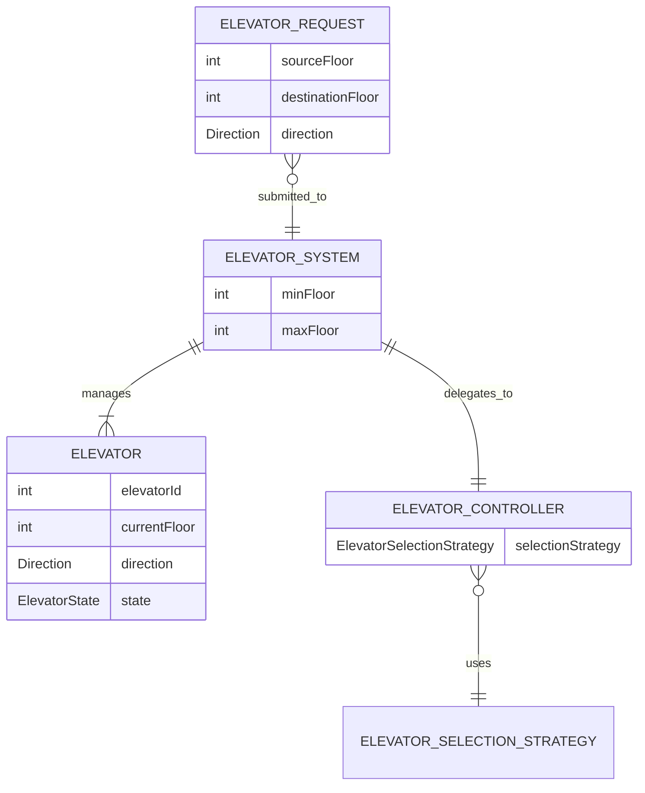
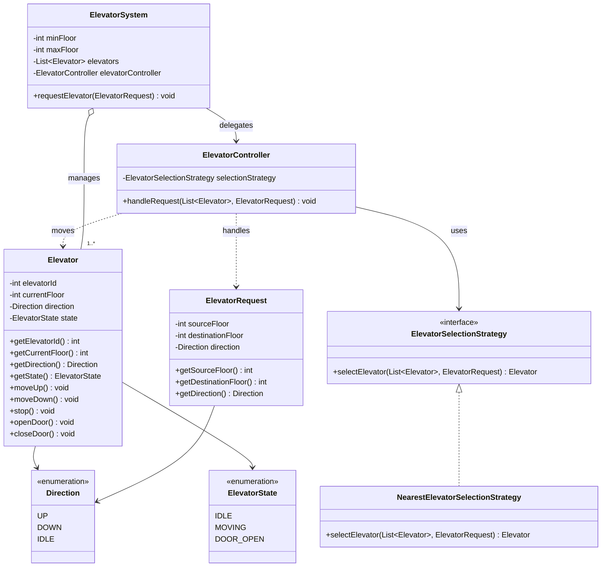

# Elevator System — Low-Level Design (LLD)

A Java-based Elevator System designed to demonstrate object-oriented design principles, the Strategy Pattern, dependency injection, separation of responsibilities, and unit testing.

## 1. Project Overview

The Elevator System simulates how a building manages multiple elevators and handles passenger requests.

A passenger submits a request specifying a source floor and a destination floor. The system validates the request, selects an appropriate elevator, moves it to the passenger's source floor, simulates passenger pickup, and then moves it to the destination floor.

The current implementation provides a synchronous, in-memory simulation without physical elevator hardware, a database, or a user interface.

### Key Features

- Manage multiple elevators within a building.
- Configure the building's minimum and maximum floors.
- Accept passenger requests with source and destination floors.
- Select the nearest idle elevator using a pluggable selection strategy.
- Simulate floor-by-floor elevator movement.
- Simulate door operations during passenger pickup and drop-off.
- Maintain elevator direction and operational state.
- Validate incoming requests against building floor limits.
- Test core controller behavior using JUnit 5.

## 2. Functional Requirements

| ID | Requirement | Status |
|---|---|---|
| FR-01 | Support multiple elevators | Implemented |
| FR-02 | Maintain each elevator's ID, current floor, direction, and state | Implemented |
| FR-03 | Accept passenger source and destination floors | Implemented |
| FR-04 | Select the nearest idle elevator | Implemented |
| FR-05 | Move an elevator one floor at a time | Implemented |
| FR-06 | Simulate passenger pickup and drop-off | Implemented |
| FR-07 | Validate request floors against building limits | Implemented |
| FR-08 | Handle the absence of an available elevator | Basic handling implemented |
| FR-09 | Queue requests when all elevators are busy | Not implemented |
| FR-10 | Support concurrent passenger requests | Not implemented |

## 3. Non-Functional Requirements and Design Goals

The following are design goals rather than fully verified production guarantees.

- **Maintainability:** Separate request handling, elevator selection, and movement responsibilities.
- **Extensibility:** Allow alternative elevator selection strategies without changing the controller's selection logic.
- **Testability:** Keep the core logic independent of external infrastructure.
- **Encapsulation:** Keep elevator state fields private and expose behavior through methods.
- **Simplicity:** Use an in-memory model and synchronous execution for the MVP.

Performance under concurrent load, fault tolerance, and production scalability are outside the current scope.

## 4. Technology Stack

| Technology | Purpose |
|---|---|
| Java 21 | Application implementation |
| Maven | Build and dependency management |
| JUnit 5 | Unit testing |
| IntelliJ IDEA | Development environment |
| Mermaid | Architecture and class diagrams in GitHub documentation |

## 5. Architecture

The system uses a layered design with distinct responsibilities.

### Component Responsibilities

| Component | Responsibility |
|---|---|
| `ElevatorSystem` | Maintains the building's floor range and elevator collection; validates requests and delegates them |
| `ElevatorController` | Coordinates elevator selection, movement, pickup, and drop-off |
| `ElevatorSelectionStrategy` | Defines the contract for choosing an elevator |
| `NearestElevatorSelectionStrategy` | Selects the idle elevator closest to the passenger's source floor |
| `Elevator` | Maintains elevator identity, current floor, direction, state, and movement/door operations |
| `ElevatorRequest` | Represents a passenger's source floor, destination floor, and derived direction |
| `Direction` | Represents `UP`, `DOWN`, or `IDLE` |
| `ElevatorState` | Represents `IDLE`, `MOVING`, or `DOOR_OPEN` |

## 6. Domain Relationship Diagram (ER-Style)

This is a conceptual domain relationship diagram, not a database ERD. The current MVP does not persist its data in a relational database.



### Relationship Explanation

- An `ElevatorSystem` manages one or more elevators.
- An `ElevatorSystem` delegates passenger requests to an `ElevatorController`.
- The controller uses an `ElevatorSelectionStrategy` to choose an elevator.
- An `ElevatorRequest` carries the information required to process a passenger journey.

## 7. UML Class Diagram

The class diagram illustrates the main classes, their responsibilities, and their relationships.



## 8. Passenger Request Flow

The following sequence describes how a passenger request is processed.

```mermaid
sequenceDiagram
    actor Passenger
    participant System as ElevatorSystem
    participant Controller as ElevatorController
    participant Strategy as NearestElevatorSelectionStrategy
    participant Elevator

    Passenger->>System: Request source and destination floors
    System->>System: Validate request and floor limits
    System->>Controller: handleRequest(elevators, request)
    Controller->>Strategy: selectElevator(elevators, request)
    Strategy-->>Controller: Selected idle elevator
    Controller->>Elevator: Move toward source floor
    Controller->>Elevator: Open and close doors
    Note over Elevator: Passenger pickup
    Controller->>Elevator: Move toward destination floor
    Controller->>Elevator: Open and close doors
    Controller->>Elevator: stop()
    Note over Elevator: Journey complete; state is IDLE
    Controller-->>System: Request processing complete
    System-->>Passenger: Request handling returns
```

The current simulation is synchronous. The controller performs the entire journey in a single method call, without modeling elapsed travel time.

## 9. Elevator Selection Strategy

The system uses the Strategy Pattern to separate elevator selection from request execution.

### Interface

`ElevatorSelectionStrategy` defines a contract for selecting an elevator from a collection of elevators for a passenger request.

### Current Implementation

`NearestElevatorSelectionStrategy`:

1. Iterates through the available elevators.
2. Considers only elevators in the `IDLE` state.
3. Calculates the absolute distance between each eligible elevator's current floor and the passenger's source floor.
4. Selects the elevator with the smallest distance.
5. Returns `null` if no idle elevator is available.

If two elevators are equally close, the current implementation keeps the first one encountered in the list.

### Complexity

For `n` elevators:

- Time complexity: **O(n)** — each elevator is examined at most once.
- Auxiliary space complexity: **O(1)** — the strategy maintains a constant number of variables, excluding the input collection.

### Why the Strategy Pattern?

The selection algorithm can be replaced or extended without embedding the selection logic inside `ElevatorController`.

Potential future strategies include:

- Nearest idle elevator.
- Prefer elevators already travelling toward the passenger.
- Direction-aware scheduling.
- Load-aware or destination-aware scheduling.

Only the nearest-idle strategy is implemented in the current MVP.

## 10. Elevator State and Movement

### Direction

The `Direction` enum represents the elevator's movement direction:

- `UP`
- `DOWN`
- `IDLE`

### Elevator State

The `ElevatorState` enum represents the elevator's operational state:

- `IDLE` — not actively moving.
- `MOVING` — performing a movement step.
- `DOOR_OPEN` — doors are open for passenger pickup or drop-off.

### Movement Operations

| Method | Behavior |
|---|---|
| `moveUp()` | Increments the current floor by one and sets direction to `UP` and state to `MOVING` |
| `moveDown()` | Decrements the current floor by one and sets direction to `DOWN` and state to `MOVING` |
| `openDoor()` | Sets the state to `DOOR_OPEN` and direction to `IDLE` |
| `closeDoor()` | Sets the state to `IDLE` |
| `stop()` | Sets direction and state to `IDLE` |

The controller uses floor comparisons to decide whether the elevator should move up or down toward its current target.

The current implementation models state transitions simply. It does not separately track door position, physical movement, travel time, or sensor feedback.

## 11. Validation and Error Handling

The MVP includes basic input and state validation.

- The elevator ID must be greater than zero.
- An elevator's initial floor cannot be negative in the current model.
- The building's minimum floor must be less than its maximum floor.
- The elevator collection must not be null or empty.
- The elevator controller must not be null.
- A passenger request must not be null.
- Source and destination floors must fall within the building's configured range.
- If the selection strategy returns no elevator, the controller throws an `IllegalStateException`.

The `ElevatorSystem` supports configurable floor limits, but the elevator constructor currently rejects negative starting floors. This means buildings with basement floors require a follow-up change to make elevator validation consistent with the configured building range.

The current implementation also relies on the system validating requests before the controller moves an elevator. The controller itself does not independently validate building boundaries.

## 12. Project Structure

```text
elevator-system/
├── pom.xml
├── README.md
└── src/
    ├── main/
    │   └── java/
    │       └── com/
    │           └── ashim/
    │               └── elevator/
    │                   ├── enums/
    │                   │   ├── Direction.java
    │                   │   └── ElevatorState.java
    │                   ├── model/
    │                   │   ├── Elevator.java
    │                   │   └── ElevatorRequest.java
    │                   └── service/
    │                       ├── ElevatorSelectionStrategy.java
    │                       ├── NearestElevatorSelectionStrategy.java
    │                       ├── ElevatorController.java
    │                       └── ElevatorSystem.java
    └── test/
        └── java/
            └── com/
                └── ashim/
                    └── elevator/
                        └── service/
                            └── ElevatorControllerTest.java
```

## 13. Running the Project

### Prerequisites

- JDK 21
- Maven 3.8 or later
- Git (optional, for version control)

### Clone the repository

Replace the placeholder with the actual repository URL after publishing the project.

```bash
git clone <your-repository-url>
cd elevator-system
```

### Compile and run tests

```bash
mvn clean test
```

### Package the project

```bash
mvn clean package
```

The project is a Java library-style MVP. It does not currently provide a command-line passenger interface, REST API, or standalone interactive application.

## 14. Unit Testing

The current `ElevatorControllerTest` class contains five passing test methods.

| Test | Purpose |
|---|---|
| `shouldMoveElevatorUpToSourceAndDestination()` | Verifies the final result of an upward journey |
| `shouldMoveElevatorDownToSourceAndDestination()` | Verifies the final result of a downward journey |
| `shouldSelectNearestIdleElevator()` | Verifies the expected elevator completes the journey while the farther elevator remains at its initial floor |
| `shouldThrowExceptionWhenNoElevatorIsAvailable()` | Verifies that a request fails when the strategy cannot select an elevator |
| `shouldFinishJourneyWithDoorsClosedAndElevatorIdle()` | Verifies the final floor, direction, and state |

JUnit 5 is configured through Maven. The tests use `@BeforeEach` to create a fresh controller and selection strategy before each test.

Run the suite with:

```bash
mvn clean test
```

The five controller tests have passed in the development environment. They primarily verify final outcomes; they do not provide exhaustive coverage of invalid input, every intermediate state transition, or all `ElevatorSystem` validation paths.

## 15. Design Decisions

### Constructor-Based Dependency Injection

`ElevatorController` receives an `ElevatorSelectionStrategy` through its constructor. This keeps the controller independent of a concrete selection implementation and makes it easier to substitute strategies.

### Separation of Responsibilities

- `ElevatorSystem` handles building-level request validation and delegation.
- `ElevatorController` coordinates a passenger's journey.
- `ElevatorSelectionStrategy` determines which elevator to use.
- `Elevator` owns its state and basic movement operations.
- `ElevatorRequest` represents passenger journey information.

### In-Memory Execution

All data is maintained in Java objects. This avoids introducing database and infrastructure complexity before the core LLD behavior is established.

### Synchronous Simulation

The controller moves the elevator floor by floor in a loop. This makes the MVP easy to understand and test, but it is not a realistic real-time elevator simulation.

## 16. Limitations

The following capabilities are outside the current MVP:

- Persistent storage or database integration.
- Real-time movement and travel delays.
- Request queues and scheduling across multiple pending requests.
- Concurrent passenger requests and thread safety.
- Direction-aware or load-aware elevator selection.
- Door sensors, safety interlocks, and hardware integration.
- Fault handling for elevator failures.
- User interfaces or REST endpoints.
- Comprehensive unit and integration test coverage.

## 17. Future Enhancements

Potential next iterations include:

1. Extract a reusable `moveToFloor()` helper to remove duplicated movement logic.
2. Validate elevator starting floors against the building's configured limits.
3. Add direct unit tests for `NearestElevatorSelectionStrategy`.
4. Add `ElevatorSystem` tests for floor validation and request delegation.
5. Implement a request queue when no idle elevator is available.
6. Support elevators already moving in the passenger's direction.
7. Model door state independently from elevator movement state.
8. Introduce a scheduler for multiple pending requests.
9. Add concurrency controls and thread-safety guarantees.
10. Add logging, simulation time, and operational metrics.

## 18. Learning Outcomes

This project demonstrates practical application of:

- Object-oriented design and encapsulation.
- Interface-driven design.
- The Strategy Pattern.
- Constructor-based dependency injection.
- Separation of responsibilities.
- State modeling with enums.
- Basic input validation and exception handling.
- Unit testing with JUnit 5.
- UML and Mermaid documentation.

---

**Project status:** Core Elevator System LLD MVP implemented; five controller unit tests passing.

**Scope:** Educational and interview-preparation project. Not intended for controlling real elevator hardware.
