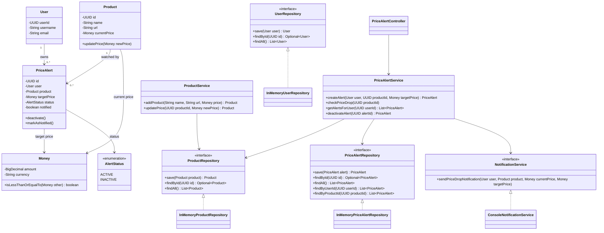
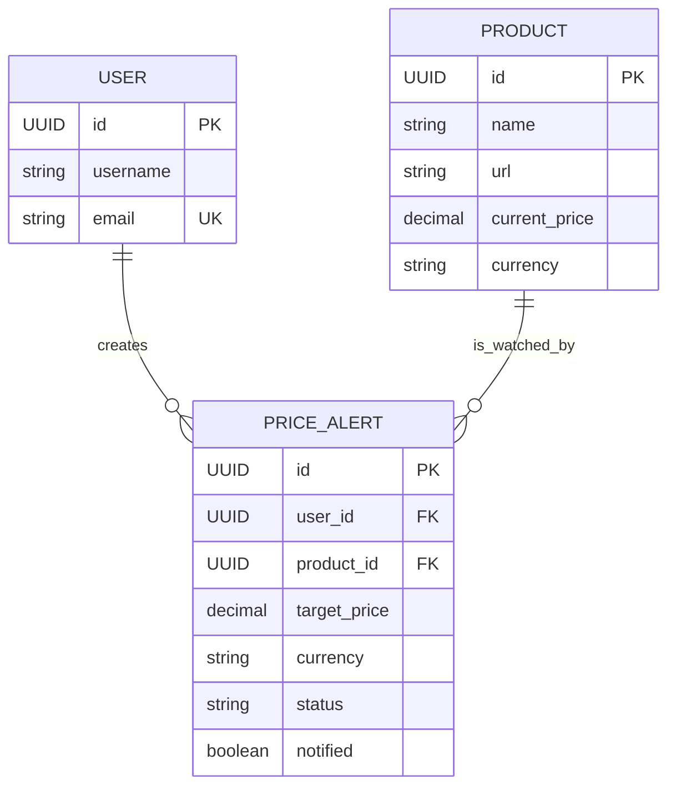

# Product Price-Drop Alert System — LLD Design Notes

A Java 21 Maven project that demonstrates object-oriented design, separation of concerns, repository abstractions, domain modeling, and unit testing for a product price-drop alert system.

> **Scope:** This is an in-memory MVP. Product prices are updated manually through the application; live retailer scraping, scheduled price checks, persistent storage, and real email/SMS delivery are not implemented.

## 1. Problem Statement

Users want to track products and receive a notification when a product's current price reaches or falls below a target price they have specified.

The system should let a user:
- Register or be represented as a user in the application.
- Add a product with its name, URL, and current price.
- Create a price alert for a product at a target price.
- Update a product's current price.
- Check whether the new price satisfies active alerts.
- Receive a notification when the target is reached.
- View alerts associated with a user.
- Deactivate an alert so it no longer triggers notifications.

## 2. Functional Requirements

1. **Add product:** Store a product name, URL, and current price.
2. **Create alert:** Associate a user and product with a target price.
3. **Validate target:** The target price must be positive, use the same currency as the product, and be strictly lower than the current product price when the alert is created.
4. **Update price:** Change the current price for an existing product.
5. **Evaluate alerts:** After a price update, evaluate active, not-yet-notified alerts for that product.
6. **Notify:** Send a notification when `currentPrice <= targetPrice`.
7. **Prevent duplicate notifications:** Mark an alert as notified after the notification call succeeds.
8. **List user alerts:** Return alerts belonging to a given user.
9. **Deactivate alert:** Change an alert's status to `INACTIVE`.

## 3. Non-Functional Requirements and Design Goals

- **Correct monetary comparisons:** Use `BigDecimal`, not floating-point types, for monetary values.
- **Currency safety:** Do not compare prices expressed in different currencies.
- **Separation of concerns:** Keep domain state, business rules, storage, notification delivery, and request orchestration in separate classes.
- **Testability:** Depend on interfaces and inject collaborators so services can be tested without a database or external notification provider.
- **Maintainability:** Keep each class focused on one responsibility.
- **Extensibility:** Allow an in-memory repository or console notifier to be replaced with another implementation later.

### Out of scope for this MVP

- Web scraping or retailer APIs to fetch prices automatically.
- A scheduler or background worker.
- Database persistence and schema migrations.
- Real email, SMS, push, or third-party notification delivery.
- Authentication/authorization, rate limiting, retries, and distributed coordination.
- Concurrent price updates and concurrent alert evaluation.

## 4. Domain Model and Entities

### `User`

Represents a person who creates price alerts.

| Field | Type | Purpose |
|---|---|---|
| `userId` | `UUID` | Unique user identifier |
| `username` | `String` | Display/login name |
| `email` | `String` | User's email address |

The constructor validates required text fields and creates a UUID. The current MVP does not implement authentication or email verification.

### `Product`

Represents a product whose price can be tracked.

| Field | Type | Purpose |
|---|---|---|
| `id` | `UUID` | Unique product identifier |
| `name` | `String` | Product name |
| `url` | `String` | Product page URL |
| `currentPrice` | `Money` | Current price and currency |

Key behavior:
- `updatePrice(Money newPrice)` validates that the new price is non-null and positive, then updates the current price.
- Price updates are currently manual; no external price provider is integrated.

### `PriceAlert`

Represents a user's request to be notified when a product reaches a target price.

| Field | Type | Purpose |
|---|---|---|
| `id` | `UUID` | Unique alert identifier |
| `user` | `User` | User who owns the alert |
| `product` | `Product` | Product being watched |
| `targetPrice` | `Money` | Price threshold |
| `status` | `AlertStatus` | Whether the alert is active |
| `notified` | `boolean` | Whether the notification has already been sent |

Key behavior:
- Starts in `ACTIVE` status and `notified = false`.
- `deactivate()` changes the status to `INACTIVE`.
- `markAsNotified()` records that notification delivery succeeded.
- The service evaluates `currentPrice <= targetPrice`.

### `Money`

A value object that represents a monetary amount and its currency.

| Field | Type | Purpose |
|---|---|---|
| `amount` | `BigDecimal` | Exact decimal amount |
| `currency` | `String` | Currency code, normalized to uppercase |

Key behavior:
- Validates amount and currency.
- Uses `BigDecimal.compareTo()` for numeric comparison.
- `isLessThanOrEqualTo(Money other)` rejects currency mismatches before comparing amounts.
- Equality and hash code are defined for value-object use.

**Why a `Money` value object?** Amount and currency form one meaningful domain value. Keeping them together reduces the risk of comparing or passing an amount without its currency.

### `AlertStatus`

Enum representing the alert lifecycle:

- `ACTIVE` — eligible for evaluation.
- `INACTIVE` — deactivated and excluded from evaluation.

The separate `notified` flag represents notification state; it is not an enum value. A notified alert can still have status `ACTIVE`, but it will not send another notification.

## 5. Class Responsibilities

### Application / Controller

| Class | Responsibility |
|---|---|
| `ProductPriceDropNotification` | Application entry point; creates/wires repository, service, and notification implementations. |
| `PriceAlertController` | Exposes application operations such as creating alerts, retrieving a user's alerts, and deactivating an alert. Delegates business work to services. |

### Services

| Class | Responsibility |
|---|---|
| `ProductService` | Adds products, retrieves products, lists products, and updates a product's current price. |
| `PriceAlertService` | Owns alert use cases: create and validate alerts, evaluate price drops, notify users, prevent duplicate notifications, list a user's alerts, and deactivate alerts. |

**Important flow detail:** Updating a price and evaluating alerts are separate operations in this MVP. The application/controller flow must call `PriceAlertService.checkPriceDrop(productId)` after `ProductService.updatePrice(productId, newPrice)`.

### Repositories

| Type | Responsibility |
|---|---|
| `ProductRepository` | Contract for saving, finding by ID, and listing products. |
| `InMemoryProductRepository` | Stores products in a `Map<UUID, Product>`. |
| `UserRepository` | Contract for saving, finding by ID, and listing users. |
| `InMemoryUserRepository` | Stores users in a `Map<UUID, User>`. |
| `PriceAlertRepository` | Contract for saving/finding alerts and querying alerts by user or product. |
| `InMemoryPriceAlertRepository` | Stores alerts in a `Map<UUID, PriceAlert>` and filters alerts by user/product IDs. |

Repositories hide the storage mechanism from service classes. The interfaces make it possible to replace in-memory storage with a database-backed implementation without redesigning the business layer.

### Notification

| Class / Interface | Responsibility |
|---|---|
| `NotificationService` | Abstraction for sending a price-drop notification to a user for a product, including current and target prices. |
| `ConsoleNotificationService` | MVP implementation that prints notification details to the console. |

`PriceAlertService` depends on the `NotificationService` interface rather than directly depending on console output. This is dependency inversion and makes notification behavior easy to mock in tests.

## 6. Class Diagram (UML)

The diagram below focuses on the main classes, interfaces, dependencies, and domain relationships. Mermaid can render this diagram in GitHub Markdown previews.




## 7. Entity Relationship Diagram (ERD)

This is the logical relational model for a future database-backed version. The current implementation is in-memory and stores object references rather than database foreign keys.




### ERD design notes

- One user can create many alerts; each alert belongs to one user.
- One product can be watched by many alerts; each alert references one product.
- `PRICE_ALERT.user_id` references `USER.id`.
- `PRICE_ALERT.product_id` references `PRODUCT.id`.
- `Money` is a value object in the Java model. A relational schema can represent it as amount + currency columns.
- The current `User` model has `username` and `email`; a database implementation could enforce a unique constraint on email if that is a product requirement.
- This ERD is a proposed persistence mapping, not an implemented database schema.

## 8. Key Use-Case Flows

### A. Create an alert

1. Controller receives the user, product ID, and target price.
2. `PriceAlertService` loads the product through `ProductRepository`.
3. Validate that target currency matches product currency.
4. Validate that target price is strictly lower than the current price.
5. Construct a `PriceAlert` in `ACTIVE` status with `notified = false`.
6. Save and return the alert through `PriceAlertRepository`.

### B. Update price and evaluate alerts

1. `ProductService.updatePrice()` updates the product's `Money` value.
2. The caller invokes `PriceAlertService.checkPriceDrop(productId)`.
3. The service retrieves alerts for the product.
4. Keep only alerts with `status == ACTIVE` and `notified == false`.
5. Load the current product price.
6. For each eligible alert, compare current price with target price.
7. If `currentPrice <= targetPrice`, call `NotificationService`.
8. Only after the notification call succeeds, call `markAsNotified()`.

### C. Deactivate an alert

1. Find the alert by ID.
2. Throw a meaningful exception if it does not exist.
3. Call `alert.deactivate()`.
4. Save and return the updated alert.
5. Subsequent price checks exclude it because its status is `INACTIVE`.

## 9. Design Decisions and LLD Concepts

### Separation of concerns

- **Model/domain:** `User`, `Product`, `PriceAlert`, `Money`, `AlertStatus`.
- **Service/business logic:** `ProductService`, `PriceAlertService`.
- **Repository/storage:** repository interfaces and in-memory implementations.
- **Notification integration:** `NotificationService` and its console implementation.
- **Controller/application orchestration:** controller and application entry point.

### Dependency inversion and constructor injection

Services depend on repository and notification interfaces, not on concrete in-memory or console implementations. Constructor injection makes dependencies explicit and enables unit testing with Mockito.

### Repository pattern

The repository interfaces isolate data access. The in-memory maps are implementation details, not business logic.

### Value object for money

`Money` groups amount and currency and centralizes comparison rules. `BigDecimal.compareTo()` avoids floating-point rounding problems and correctly treats values such as `10.0` and `10.00` as numerically equal for comparison.

### Domain behavior

`Product` owns its price-update behavior; `PriceAlert` owns its deactivation and notified-state changes. The service coordinates these behaviors rather than directly manipulating internal fields.

### Duplicate-notification guard

The service filters out alerts already marked as notified and marks an alert only after the notification call returns successfully. This prevents repeated notifications in the normal single-process flow.

**Production caveat:** This flag is not a guarantee of exactly-once delivery under process crashes, concurrent workers, or external-provider ambiguity. A production design would need persistence, idempotency, retry policy, and possibly an outbox or durable notification state machine.

## 10. Testing Strategy

Unit tests are located under:

`src/test/java/com/ashim/pricedrop/service/PriceAlertServiceTest.java`

The current test suite covers:

| Test scenario | Expected behavior |
|---|---|
| Target price equals current price | Alert creation rejected |
| Target price is above current price | Alert creation rejected |
| Target currency differs from product currency | Alert creation rejected |
| Current price is still above target | No notification; alert remains unnotified |
| Current price reaches target | Notification sent; alert marked notified |
| Price falls further after notification | No duplicate notification |

The tests use JUnit 5 and Mockito. Repositories and notification delivery are mocked, while domain objects are real instances.

Run the suite:

```bash
mvn clean test
```

At the time these notes were written, the five `PriceAlertServiceTest` test methods passed. Add tests for `getAlertsForUser()` and `deactivateAlert()` as the next testing step.

## 11. Project Structure

```text
price-drop-alert/
├── pom.xml
├── README.md
└── src/
    ├── main/
    │   └── java/com/ashim/pricedrop/
    │       ├── ProductPriceDropNotification.java
    │       ├── controller/
    │       │   └── PriceAlertController.java
    │       ├── model/
    │       │   ├── AlertStatus.java
    │       │   ├── Money.java
    │       │   ├── PriceAlert.java
    │       │   ├── Product.java
    │       │   └── User.java
    │       ├── notification/
    │       │   ├── ConsoleNotificationService.java
    │       │   └── NotificationService.java
    │       ├── repository/
    │       │   ├── InMemoryPriceAlertRepository.java
    │       │   ├── InMemoryProductRepository.java
    │       │   ├── InMemoryUserRepository.java
    │       │   ├── PriceAlertRepository.java
    │       │   ├── ProductRepository.java
    │       │   └── UserRepository.java
    │       └── service/
    │           ├── PriceAlertService.java
    │           └── ProductService.java
    └── test/
        └── java/com/ashim/pricedrop/service/
            └── PriceAlertServiceTest.java
```

## 12. Build and Run

Requirements:
- JDK 21
- Maven

Run tests:

```bash
mvn clean test
```

Compile the project:

```bash
mvn clean compile
```

Run the application using your IDE's run configuration for `ProductPriceDropNotification`, or use the Maven/Java command appropriate to the entry-point wiring in your current version.

## 13. Future Improvements

A sensible implementation roadmap:

1. Add unit tests for listing and deactivating alerts.
2. Add controller-level validation and clear error responses.
3. Add an explicit application flow that updates the product price and then evaluates alerts.
4. Replace in-memory repositories with a database implementation.
5. Add a scheduled price-fetching component and a `PriceProvider` abstraction for retailer APIs.
6. Add durable notification state, retries, idempotency, and observability.
7. Consider concurrency behavior if multiple price checks can run at the same time.
8. Add integration tests for repository persistence and end-to-end alert flows.

## 14. LLD Interview Summary

When explaining this design in an interview:

- Start with the functional requirements and scope.
- Identify the core entities: `User`, `Product`, `PriceAlert`, and `Money`.
- Explain the one-to-many relationships: a user can own many alerts, and a product can be watched by many alerts.
- Separate business logic into services and storage behind repository interfaces.
- Explain why `Money` is a value object and why `BigDecimal` is used.
- Walk through alert creation, price evaluation, notification, and duplicate prevention.
- Explain how constructor injection and interface-based dependencies make unit testing straightforward.
- Be explicit about MVP limitations: in-memory state, manually updated prices, console notifications, and no concurrency/durability guarantees.

The main LLD lesson is that domain rules stay in the model and service layer, while storage and notification mechanisms are replaceable collaborators.
